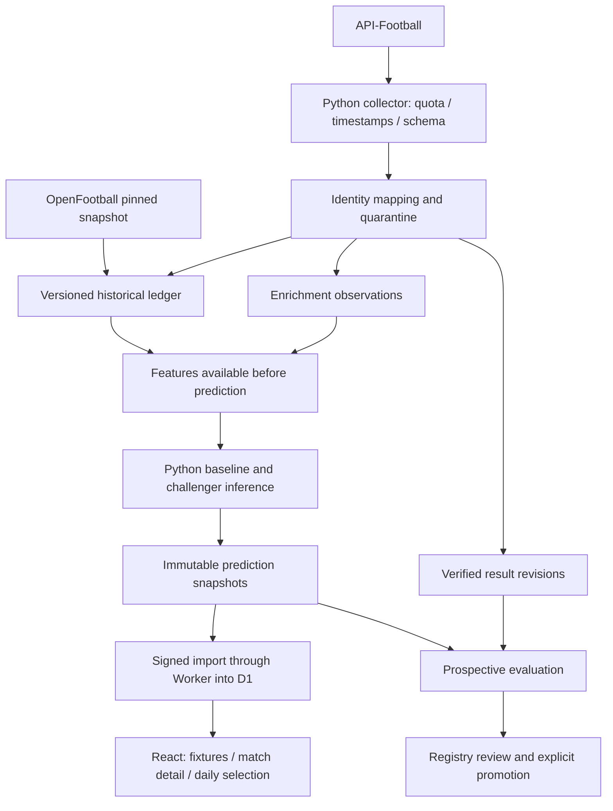

# วิเคราะห์ API-Football กับ Football Prediction AI

สถานะภายหลังการวิเคราะห์: พัฒนาและทดสอบ local research integration แล้ว ดู [ผลดำเนินงานล่าสุด](LIVE_RESEARCH_IMPLEMENTATION_TH.md) เอกสารด้านล่างเก็บข้อเสนอและผลตรวจ ณ เวลาวิเคราะห์เดิม

ตรวจวันที่ 26 ตุลาคม 2026 ตาม Asia/Bangkok จากโค้ดจริง, เอกสารผู้ให้บริการ และการเรียกบัญชีนี้จริง สถานะเอกสาร: ผลตรวจและข้อเสนอสำหรับพัฒนาต่อ ไม่ใช่ประกาศว่าเปิด production หรือฝึกด้วยข้อมูล API ใหม่แล้ว

## 1. คำตอบหลัก

API นี้เติมส่วนที่ข้อมูลสกอร์ย้อนหลังขาดได้ ได้แก่ โปรแกรม/สถานะปัจจุบัน, นักเตะขาด, ตัวจริงเมื่อมีข้อมูล, สถิติการเล่นและ xG รายแมตช์, ผลงานรายผู้เล่น และคำทำนายของผู้ให้บริการ โอกาสพัฒนาจึงอยู่ที่การเชื่อมข้อมูลเหล่านี้กับเวลาและตัวตนทีมให้ถูกต้อง แล้วพิสูจน์ด้วยคำทำนายก่อนแข่งจริง

การเชื่อมสำเร็จยังไม่ทำให้โมเดลแม่นขึ้นทันที โมเดล Precision v3 ยังใช้ 58 features จากผลสกอร์และประวัติเดิม ข้อมูลเสริมที่ตรวจครั้งนี้ยังไม่ถูกนำไปฝึก ไม่ปรับเปอร์เซ็นต์ย้อนหลัง และไม่เลื่อน active model

ข้อเสนอคือคง OpenFootball เป็นฐานผลย้อนหลัง 4–5 ปี, ใช้ API-Football อัปเดตข้อมูลปัจจุบัน/สะสมข้อมูลเสริม และพัฒนาโมเดลใหม่แยกเวอร์ชันหลังมีหลักฐานพอ ไม่บังคับเปลี่ยนทุกอย่างเป็น API ซึ่งบัญชีฟรีมีข้อจำกัดการเรียกย้อนหลัง

## 2. ผลที่ทดสอบจริงของบัญชีนี้

บัญชีเป็น API-Sports โดยตรง Free active โควตา 100/day; header ล่าสุดหลังการตรวจเพิ่มรายงาน remaining 87, minute limit 10 ณ เวลานั้น รวมตั้งแต่เริ่มเชื่อม 16 HTTP requests: status 1, coverage 5, fixture filter ที่ถูกปฏิเสธ 2, date fixtures 2 และ enrichment samples 6 ตัวนับ local กันงบแบบเผื่อ 15 billable attempts ไม่มีการซื้อแพ็กเกจเพิ่ม

| ข้อมูล | Endpoint | ผลตรวจจริง | ขอบเขตที่ยืนยันได้ |
|---|---|---|---|
| บัญชี/โควตา | `/status` | สำเร็จ | ไม่เก็บ raw response ที่มีชื่อ/อีเมล |
| ลีก/ฤดูกาล/coverage | `/leagues?id=...` | สำเร็จทั้งห้าลีก | catalog ไม่รับรองสิทธิ์ทุก query |
| โปรแกรมจริง | `/fixtures?date=...&timezone=Asia/Bangkok` | สองวันสำเร็จ | กรองได้ 16 คู่ในรอบ 06:00 ของห้าลีก |
| season filter 2026 | `/fixtures?league=39&season=2026` | ถูกปฏิเสธ | ข้อความให้ใช้ season 2022–2024 |
| date ย้อนปี 2024 | `/fixtures?...&date=2024-10-27` | ถูกปฏิเสธ | ข้อความระบุวันที่ที่รับได้ 2026-10-24 ถึง 2026-10-26 ขณะทดสอบ |
| สถิติทีมรายเกม | `/fixtures/statistics?fixture=1557441` | 2 ทีม | พบ 17 ชนิดสถิติใน Crystal Palace–Newcastle ที่จบแล้ว |
| xG | ฟิลด์ `expected_goals` ใน statistics | พบค่าตัวเลข 1.78 และ 1.03 | ยืนยันเพียงแมตช์ตัวอย่างนี้ ไม่ใช่ทุกลีก/ทุกนัด |
| ผลงานผู้เล่นรายเกม | `/fixtures/players?fixture=1557441` | 2 ทีม ฝั่งละ 20 รายการ | จำนวนรายการไม่ใช่จำนวนผู้เล่นที่ลงสนามจริง ต้องตรวจ minutes |
| ตัวจริงก่อนเกม | `/fixtures/lineups?fixture=1570426` | HTTP สำเร็จ แต่ response ว่าง | ไม่ยืนยันว่ามีตัวจริงครบหรือว่าทีมไม่มีผู้เล่น |
| นักเตะขาด | `/injuries?fixture=1570426` | 18 รายการ `Missing Fixture` | ข้อมูลผู้ให้บริการก่อน Barcelona–Real Madrid ไม่ใช่ 18 คนบาดเจ็บทั้งหมด |
| คำทำนายผู้ให้บริการ | `/predictions?fixture=1570426` | 1 ชุด | H/D/A = 45/45/10%, มี comparison และ H2H 10 นัดแนบมา |
| H2H | `/fixtures/headtohead?h2h=529-541` | 51 นัด | รวมหลายรายการและหลายปี ต้องกรองก่อนใช้งาน |

โปรแกรมที่แคชไว้ยังเป็นรอบ 25 ตุลาคม 06:00 → 26 ตุลาคม 06:00 เพราะเก็บก่อนถึง 06:00 ของวันที่ 26: EPL 5, La Liga 4, Bundesliga 2, Serie A 5, Championship 0 เป็นข้อมูล ณ เวลาดึง ไม่ได้ refresh ใหม่ในรอบวิเคราะห์นี้

ตัวอย่างสถิติทีมและผู้เล่นถูกดึงหลังเกมจบ ใช้ศึกษาฟีเจอร์ของเกมถัดไปได้เมื่อผ่านการตรวจ แต่ห้ามอ้างว่ามีข้อมูลเหล่านั้นก่อนเกมเดิม ส่วน injury/prediction/H2H ของ Barcelona–Real Madrid ได้บันทึกก่อน kickoff จริง พร้อม hash และเวลารับ response โดยยังไม่แสดงเป็นคู่แนะนำ

หลักฐาน [capability-samples.json](../reports/api-football/capability-samples.json), [date-smoke-test.json](../reports/api-football/date-smoke-test.json)

## 3. API มีอะไรอีก และเราควรใช้ระดับใด

รายการต่อไปนี้เป็นความสามารถตามเอกสาร ไม่ใช่การยืนยันสิทธิ์ของบัญชีนี้ทุก endpoint ดู [เอกสาร v3](https://www.api-football.com/documentation_v3) และ [คู่มือภาพรวม](https://www.api-football.com/news/post/how-to-get-started-with-api-football-the-complete-beginners-guide)

| กลุ่ม | Endpoint ตัวอย่าง | ใช้กับโปรเจกต์ | ลำดับ |
|---|---|---|---|
| Reference | countries, timezone, leagues/seasons | ตรวจ identity/ขอบเขตเวลา | cache ไว้ ใช้น้อย |
| ทีม/สนาม | teams, teams/statistics | จับรหัสทีมและสถิติแยกเหย้าเยือน | หลังตรวจ season/query permission |
| ตารางคะแนน | standings | แสดงอันดับและเทียบคะแนนที่เราคำนวณ | เสริม UI; อย่าเอาตารางท้ายฤดูใส่เกมต้นฤดู |
| เหตุการณ์ | fixtures/events | อธิบายประตู/ใบแดง/การเปลี่ยนตัวหลังเกม | ช่วยตรวจผลและสร้างฟีเจอร์เกมถัดไป |
| ฤดูกาลผู้เล่น | players, players/squads | baseline นาทีและบทบาทของนักเตะ | ต้องตรวจการเข้าถึงและ pagination |
| โค้ช/ย้ายทีม | coachs, transfers, players/teams | ประวัติการเปลี่ยนทีม/โค้ช | เพิ่มเมื่อมีเหตุผลและวันเริ่มใช้ชัด |
| ประวัติผู้เล่นขาด | sidelined | ประวัติขาด/พักแข้งตามข้อมูลที่มี | ไม่อนุมานว่าทุกวันที่ขาดจะทราบล่วงหน้า |
| ราคา | odds, odds/live | benchmark/บริบทเพิ่มเติม | ยังไม่ทดสอบ; ไม่จำเป็นต่อโมเดลระยะแรก |
| รูป/โลโก้ | media URLs | ตกแต่ง UI | ตรวจสิทธิ์รูปก่อนเผยแพร่ |

ยังไม่เพิ่มระบบข่าวตามความต้องการเดิม ข้อมูลนักเตะที่วิเคราะห์ในเอกสารนี้เป็นข้อมูลโครงสร้างจาก API ส่วน weather, GPS/tracking, post-shot xG, ความฟิตภายในทีม หรือเหตุผลเชิงลึกที่ payload ไม่มี ต้องระบุว่าไม่ทราบ ไม่สร้างแทน

## 4. สิทธิ์ข้อมูลต้องประเมินเป็นสามขั้น

1. **มีใน catalog/coverage**: ผู้ให้บริการตั้งเป้าเก็บข้อมูลนั้นสำหรับลีก/ฤดูกาล
2. **บัญชีเรียก query นั้นได้**: ไม่มี HTTP/body error เรื่อง plan/permission
3. **มีข้อมูลจริงและทันเวลา**: response ไม่ว่าง, identity ถูก, field ใช้ได้, รับข้อมูลก่อน prediction cutoff

ตัวอย่าง lineups ของเราผ่านข้อ 1 และรับ response สำเร็จ แต่ยังไม่มีข้อมูลให้ใช้จริง ค่าว่างต้องเป็น unknown ห้ามสร้างรายชื่อหรือกำลังทีมเป็นศูนย์ การทดลอง xG ผ่านครบเฉพาะสถิติหลังเกมตัวอย่าง ไม่รับรอง pre-match availability ของเกมนั้น

ต้องมี capability matrix ต่อ `endpoint + league + season + query shape` เช่น date-only ใช้ได้ แต่ league/season ใช้ไม่ได้ ผลต้องมี first_verified_at/last_checked_at/expiry ไม่ตั้ง boolean เดียวว่า API พร้อมทุกอย่าง

## 5. จุดขาดที่พบจากโค้ดจริง

| ส่วน | ปัจจุบัน | สิ่งที่ต้องปรับ |
|---|---|---|
| `scripts/api_football_schedule.py` | สอง date requests + status, local file ledger | ย้ายไป collector ที่ใช้ quota ร่วมกัน, ทนต่อ partial date coverage |
| `apps/api/jobs.ts:runSync` | ยังเรียก `{league:39,season:2026}` | เปลี่ยนตาม query ที่บัญชีทดสอบผ่าน ไม่เปิด flag อย่างเดียว |
| leagueMap ใน jobs | มี EPL/La Liga/Bundesliga สามลีก | เพิ่ม league registry ที่ตรวจแล้วให้ตรงกับ preview ห้าลีกและชุดประวัติ |
| upsert ทีม | สร้าง `provider-<id>` | เชื่อมเข้ากับ canonical team ID ก่อนสร้าง features |
| fixture score | รับเพียง `goals` | แยกผล 90 นาที/ต่อเวลา/จุดโทษและสถานะ |
| `match_date` | slice วันที่จาก ISO ที่ provider ส่งมา | เก็บ UTC, วันสนาม, business date แยกกัน |
| feature engine | โหลด accepted recent-v2 และ default cutoff จาก training artifact | แยกเวลาฝึก weights กับเวลาข้อมูลล่าสุดที่ใช้สร้าง features |
| inference ใน jobs | Poisson fallback จาก features table | ผูกกับ approved artifact/schema จริง; ไม่มี approved model ให้ abstain |
| snapshots DB | CHECK mode เป็น mock_research | เพิ่ม schema สำหรับ private/live ที่ไม่เขียนทับหลักฐานเดิม |
| preview UI | อ่านแคชโปรแกรมจริง แต่ยังไม่มีรายละเอียดโมเดล | ค่อยเชื่อม detail หลัง mapping/freshness ผ่าน |
| quota | Python local กับ D1 Worker คนละ ledger | ใช้ broker/ตัวนับเดียวก่อนเปิด automation |
| model registry | active=null | ยังไม่ promote จากผลทดสอบ API เพียงอย่างเดียว |
| batch/training workflows | batch ยัง dry-run และ training schedule เดิมเรียก pipeline รุ่นก่อน | เปลี่ยนเป็น pipeline/feature schema ที่เลือกจริงและทดสอบ signed import ก่อนเปิด |
| Cloudflare config | ไม่มี cron และ D1 ID ยังเป็น placeholder | สร้าง/ผูกทรัพยากรจริงภายหลังการอนุมัติ deploy |

การอ่าน `PrecisionEngine.snapshot()` พบว่า cutoff ค่าเริ่มต้นมาจาก `training_cutoff_exclusive` และ `predict()` เรียกใช้ค่าเริ่มต้นนี้ ดังนั้นการใส่ผลใหม่เข้าฐานข้อมูลเพียงอย่างเดียวจะยังไม่ทำให้ features สดขึ้นตามที่ต้องการ ต้องแก้และทดสอบเส้นทางนี้โดยตรง

โครงสร้างเดิมสร้าง snapshots และผลย้อนหลังได้แล้ว แต่เส้นทาง sync → canonical mapping → state ล่าสุด → โมเดล v3 → คำทำนายจริง ยังไม่ต่อครบ

## 6. Team identity เป็นงานเร่งด่วนอันดับแรก

ตรวจ 32 ทีมจาก 16 คู่แบบ offline โดยไม่เรียก API เพิ่ม:

- ตรงชื่อกับ vocabulary เดิม 9 ทีม
- เสนอ candidate ได้จาก normalized exact แบบไม่กำกวม 10 ทีม แต่ยัง unverified
- วิธีเดิมยังหา candidate ไม่ได้ 13 ทีม

ตัวอย่างชื่อที่ยังไม่ resolve: Newcastle, Brighton, Leeds, Getafe, Celta Vigo, Levante, Inter, Fiorentina, Atalanta, Frosinone, Genoa, Lecce, Udinese ไม่ได้หมายความว่าข้อมูลประวัติไม่มีทีมเหล่านี้ทั้งหมด หลายกรณีเป็นคนละชื่อทางการ/ชื่อย่อ ต้องตรวจหลักฐาน ไม่เดาจากความคล้าย

mapping ควรเก็บ provider, provider_team_id, canonical_team_id, country, valid_from/valid_to, evidence, reviewed_at, status และตรวจไม่ให้สองทีมที่แข่งกัน map เป็นทีมเดียวกัน แยกทีมชาย/หญิง/สำรอง/U21 และการเปลี่ยนชื่อ/รวมสโมสร

ต้องใช้ canonical club ID เดียวข้ามการเลื่อนชั้น แต่คำนวณความแข็งแกร่งตามระดับลีกและประวัติที่มี ไม่เอาค่าเฉลี่ย Championship ไปเทียบ EPL ตรง ๆ โดยไม่ปรับ ทีมที่ข้อมูลไม่พอให้ cold-start/shrinkage และยังไม่เข้า high-confidence selection

หลักฐาน [team-mapping-audit.json](../reports/api-football/team-mapping-audit.json) เป็นข้อเสนอ mapping เท่านั้น ยังไม่มีรายการใดถูกเลื่อนเป็น verified ในรอบนี้

## 7. Normalize แมตช์และเวลาให้รองรับการใช้งานจริง

เก็บอย่างน้อย `provider_fixture_id`, `competition_id`, `season`, `home/away canonical IDs`, `kickoff_utc`, `competition_local_date`, `business_date_bangkok`, `status`, `score_90`, `score_extra_time`, `score_penalties`, `first_seen_at`, `fetched_at`, `provider_updated_at` ถ้ามี และ source payload hash

business day เป็น 06:00 กรุงเทพถึงก่อน 06:00 วันถัดไป; tonight เป็น 18:00 ถึงก่อน 06:00 ภายในรอบเดียวกัน ใช้ช่วง `[start,end)` ไม่รวมจุดสิ้นสุด เกม 05:59 อยู่รอบเดิม เกม 06:00 อยู่รอบใหม่ ไม่ใช้วันที่จาก ISO slice เป็น identity และไม่สมมติว่าทุกการแข่งขันอยู่ timezone เดียวกับไทย

สถานะ NS/TBD, live/HT/2H, FT, AET/PEN, postponed/cancelled/abandoned, awarded/walkover ต้องแยกชัด 1X2 ประเมิน 90 นาทีและทดเวลา ไม่เอาผลชนะจุดโทษมาเป็น away/home win 90 นาที สกอร์หายยังคง null และสถานะไม่ยืนยันต้องพักไว้

เมื่อเลื่อนเตะให้เก็บ schedule revision/fixture occurrence แทนเปลี่ยนเวลาบนคำทำนายเก่า รายงานเก่าตัดสิน void/reduced ตามกติกาที่ล็อกไว้ แล้วสร้างคำทำนายสำหรับกำหนดเตะใหม่พร้อมอ้างอิง snapshot เดิม การแข่งซ้ำ/เพลย์ออฟ/บอลถ้วยต้องไม่ใช้ unique constraint เหย้า–เยือนต่อฤดูกาลแบบลีกปกติอย่างเดียว

## 8. ข้อมูล API แต่ละชนิดช่วยโมเดลอย่างไร

### ผลล่าสุดและความต่อเนื่อง

อัปเดต form/Elo/จำนวนเกมเหย้าเยือนและสถานะเลื่อนเตะก่อน ช่วยแก้การใช้ข้อมูลเก่าโดยตรง ต้องแยกการอัปเดต state จากการฝึก weights ใหม่ เก็บ dataset version เพิ่มเติมแบบ append-only ไม่เขียนทับ recent-v2 ที่ใช้สร้างหลักฐานเดิม

### xG และสถิติการยิง

เราเจอ `expected_goals` จริง 1.78 กับ 1.03 ในแมตช์ตัวอย่าง นำไปออกแบบ rolling xG for/against, goal–xG residual, shot-on-target ratio, shots inside box และความผันผวนในเกมก่อนหน้าได้ ใช้น้ำหนักตามความใหม่และคู่แข่ง พร้อม sample size และ missing indicators

ห้ามเอา xG ของคู่ที่กำลังจะทายเข้าฟีเจอร์ก่อนเกม และห้ามนำ xG ที่เพิ่งดึงวันนี้ไป backtest ว่าทราบก่อนเกมเก่าแล้ว ค่า expected goals จาก Poisson/Dixon–Coles ของเราเป็นคนละที่มากับ event-based xG ใน API ต้องติดป้ายแยก

ค่า null/N/A/NaN ไม่เป็นศูนย์; xG 0.0 ที่เป็นตัวเลขใช้ได้ เกมที่ต่อเวลาอาจมีสถิติ 120 นาที ต้องรู้ phase/ช่วงเวลาหรือแยกออกเมื่อเทียบฟีเจอร์ 90 นาที

### นักเตะขาดและตัวจริง

เก็บ missing/questionable, เหตุผล, player/team/fixture IDs และเวลา ไม่ใช้จำนวนคนขาดอย่างเดียว น้ำหนักควรพิจารณานาทีที่เคยลง ตำแหน่ง/บทบาท ผลงานก่อนเกม และคุณภาพตัวแทน โดย shrinkage เมื่อข้อมูลน้อย ไม่มีการตั้งเองว่า “ขาดกองหน้าหนึ่งคนลดโอกาสชนะ 10%”

ตัวจริงยืนยันได้จึงค่อยสร้าง lineup strength/rotation เทียบ usual XI ก่อนหน้า ถ้ารายชื่อมาไม่ทัน cutoff ใช้โมเดลก่อนตัวจริงและแสดงว่าไม่ทราบ ห้ามเติม actual XI หลังแข่งเข้า snapshot ก่อนเกม

### ผลงานผู้เล่น

ตัวอย่างได้ฝั่งละ 20 รายการ แต่ต้องกรองคนที่ minutes >0 การมีรายการใน roster หรือค่า minutes=0 ไม่ได้แปลว่าลงเล่น ผู้เล่นไม่มีนาทีไม่ควรได้ rating 0 มาเฉลี่ยทำให้ทีมอ่อนลงผิด ๆ ต้องสร้าง baseline จากผลงานที่มี sample พอและปรับตามตำแหน่ง

### ภาระการแข่งขัน

คำนวณวันพัก/นาทีใน 7–14 วันจากทุกถ้วยที่ตรวจได้ ไม่เรียก league gap เดิมว่า rest days จริงหากทีมเพิ่งเล่นยุโรปหรือบอลถ้วย การย้ายทีม/โค้ชต้องมีวันที่มีผลและเวลาที่ทราบก่อนเกม

### ตารางคะแนนและ team statistics

ใช้เป็นบริบท UI หรือ cross-check กับที่คำนวณเอง สถิติเต็มฤดูท้ายปีห้ามเข้าทำนายเกมต้นฤดู อันดับจากผลใน dataset อาจต่างจากอันดับ official เมื่อมีการหักแต้ม/ตัดสินทางปกครอง จึงต้องแสดงแหล่งที่มาและเวลา ไม่บังคับให้เท่ากันด้วยการเดา

## 9. H2H ต้องกรองอย่างไร

Barcelona–Real Madrid ที่ API ส่งมา 51 นัด ครอบคลุม La Liga, Copa del Rey, Super Cup, Friendlies Clubs และ International Champions Cup

หลังกรองช่วง 2021-10-25 ถึงก่อน kickoff เป้าหมายและเฉพาะ FT ที่มีสกอร์ เหลือ 19 นัดทุกถ้วย; เฉพาะ La Liga เหลือ 9 นัด ไม่ใช้ค่า 51 เป็น sample ของลีกและห้าปีโดยอัตโนมัติ

หน้า detail ควรเลือก “ลีกเดียวกัน/ทุกถ้วยที่มีข้อมูล” และ “5/10/20 นัด” แสดง sample จริง เช่น มีเพียง 9 ก็แสดง 9 ไม่เติมให้เป็น 10 ถ้าใช้ผล 90 นาทีของ AET/PEN ต้องยืนยัน score.fulltime ก่อน

H2H เหมาะเป็นบริบท มีทีม/ผู้เล่น/โค้ชเปลี่ยนตลอด จึงไม่ควรให้ H2H เปอร์เซ็นต์ชนะเท่ากับความน่าจะเป็นของเกมใหม่โดยตรง

หลักฐาน [h2h-sample-audit.json](../reports/api-football/h2h-sample-audit.json)

## 10. ใช้ Predictions ของ API อย่างไร

ให้เป็น external benchmark อีกตัว แสดงข้างโมเดลเรา และเก็บก่อนเกมเพื่อวัดผลบนคู่/เวลาเดียวกัน โมเดล API อาจใช้ข้อมูลคล้ายเรา ผลจึงไม่ได้เป็นหลักฐานอิสระสองชุดและไม่ควรเฉลี่ยน้ำหนัก 50:50 โดยไม่มี validation

ตัวอย่าง API ส่ง H/D/A 45/45/10 รวมเป็น 100% ภายใน forecast นี้ home-or-draw เท่ากับ 90% แต่ไม่ใช่การทายเหย้าชนะ 90% และไม่ใช่หลักฐานว่าทายถูกจริง 90% การเพิ่ม Double Chance ต้องเป็นตลาดใหม่ที่วัดแยก

`comparison.att/def/form/poisson_distribution` เป็นค่าประกอบของผู้ให้บริการ ไม่ใช่ 1X2 probabilities โดยอัตโนมัติ `under_over` หรือ `goals.home` อาจเป็นข้อความ/เส้น เช่น -1.5 จึงไม่แปลงเป็น lambda ประตู -1.5 หรือ xG -1.5

ถ้าจะสร้าง ensemble ให้ใช้เฉพาะ provider forecasts ที่บันทึกก่อนแข่งและ OOF ของโมเดลเรา ฝึก/สอบเทียบน้ำหนักจาก validation และ freeze ก่อน test ถ้า API ไม่เพิ่มประโยชน์ ให้คงเป็นข้อมูลเปรียบเทียบใน UI

## 11. โมเดลควรเปลี่ยนเป็นลำดับ

| รุ่น/ชั้น | ข้อมูล | สถานะ/เงื่อนไข |
|---|---|---|
| v3 score baseline | 58 features เดิม + state ผลล่าสุดที่นิยามเหมือนเดิม | ต้องแก้ mapping/cutoff ก่อนใช้จริง |
| Challenger A | baseline + xG/shot quality จากเกมก่อน | เริ่มสะสม coverage และทดสอบ ablation |
| Challenger B | A + injuries/lineups/player contribution | ต้องมี availability timestamps และประวัติพอ |
| Challenger C | โมเดลเรา + provider forecast | ใช้ชุด forecasts ก่อนเกมจริง; น้ำหนักเรียนจาก validation |

ยังไม่มีประวัติ xG/lineups แบบครบย้อนหลัง 4–5 ปีจากบัญชีฟรีนี้ จึงไม่สามารถฝึกโมเดล rich features ให้เหมือนมีข้อมูลครบ 17,027 เกมในวันนี้ได้ ระยะแรกแสดงข้อมูลเสริมและเก็บ shadow predictions ก่อน ข้อมูลย้อนหลังที่ไม่มี API features ต้อง missing ไม่สร้าง xG จากสกอร์แล้วเรียกว่าข้อมูลจริง

ฟีเจอร์ใหม่ต้องมี schema/version ใหม่ รักษา weights ที่ฝึกกับ 58 ค่าไว้ ไม่ยัดคอลัมน์เพิ่มเข้าโมเดลเดิม การที่ข้อมูลเสริมมีเฉพาะลีกใหญ่หรือคู่เด่นยังทำให้ sample bias; การเก็บหลังเกมควรมีแผนกระจายลีก/ความแข็งแกร่ง ไม่เลือกเก็บเฉพาะคู่ที่ทายถูก

ต้องแยก `weights_training_cutoff`, `feature_information_cutoff` และ `prediction_generated_at` ข้อมูล feature ต้องทราบก่อน generated_at และ generated_at < kickoff ทั้งนี้นิยามเวลาแบบรายวันของ v3 กับรายนาทีของรุ่นใหม่ต้องแยก schema และทดสอบ parity ไม่เปลี่ยนพฤติกรรมย้อนหลังเงียบ ๆ

## 12. โครงสร้างข้อมูลที่เสนอ

ตารางเดิมมีส่วนใช้งานได้ เช่น leagues, teams, fixtures, features, feature_snapshots, model_versions, registry, predictions, evaluations และ quota/cache จึงเพิ่มเฉพาะช่องว่างด้วย migration ใหม่ ไม่แก้ migration ที่ใช้แล้วหรือเขียนทับหลักฐาน immutable

| ตาราง/กลุ่มที่ควรเพิ่ม | ประโยชน์ |
|---|---|
| provider_capabilities | สิทธิ์ endpoint/query ต่อ league/season พร้อมเวลาตรวจ |
| provider_team_mappings | canonical mapping, หลักฐานและช่วงเวลาใช้ |
| fixture_observations / schedule_revisions | สถานะ/ผล/เวลาแต่ละเวอร์ชันและ first_seen |
| team_match_statistics | metric, value, unit, phase, team/fixture IDs |
| player_match_statistics | minutes, position, performance พร้อมสถานะ did_not_play |
| availability_observations | missing/questionable/coverage/เวลา |
| lineup_snapshots | confirmed XI/formation/substitutes พร้อมเวลารับ |
| provider_forecasts | raw typed forecast + probability validation + captured_at |
| live_feature_snapshots | schema, values, source hashes, cutoff และ missing flags |
| live_prediction_snapshots | weights/goal component/data versions, stage และ hash |
| outcome_revisions / settlement_versions | ผลแก้ไขและการคิดคะแนนใหม่ที่ตรวจย้อนหลังได้ |

source snapshots ของ API ต้องมีเงื่อนไขจัดเก็บแยกจาก OpenFootball CC0/OpenLigaDB ODbL ไม่เปลี่ยน raw API เป็น CC0 ด้วยการนำมา join ภายในฐานข้อมูล ตาราง normalized ที่ใช้งานประจำควรมี index ตาม fixture/team/league/time ส่วน raw payload ใหญ่เก็บแบบจำกัดอายุและอ้าง hash ภายใต้สิทธิ์ที่ตรวจแล้ว

## 13. โครงสร้างการทำงานที่เสนอ

แยกหน้าที่: React อ่าน API ของเรา, Worker จัดสิทธิ์/อ่าน D1/รับ signed batches/ประเมินงานเบา, Python บน GitHub Actions ทำ parse ข้อมูลใหญ่ สร้างฟีเจอร์ inference และฝึกโมเดล งาน cloud จะทำต่อได้โดยไม่ต้องเปิด PC หลัง deploy/workflow ได้รับอนุมัติและตั้งค่าจริงแล้ว

แนะนำ collector ที่เป็นทางออก provider เพียงจุดเดียว ใช้ global quota broker เดียวร่วมกับ D1 ทุก request ต้อง reserve ticket ก่อนออกและ reconcile headers หลังกลับ ไม่ใช้ file ledger ใน Python กับ ledger ใน Worker แยกกันพร้อม ๆ กัน

API response วันที่ 25 มี 1,266 fixtures ขนาด 1,241,457 bytes วันที่ 26 มี 265 fixtures ขนาด 261,567 bytes จึงควร normalize/filter ใน Python ก่อนส่ง D1 อย่าให้ทุก page view parse raw ทั้งโลกหรือโหลดประวัติทั้งหมดเพื่อทำนายใหม่

## 14. งบโควตาตัวอย่างสำหรับระยะแรก

ตัวเลขนี้เป็น **ข้อเสนอการจัดสรร** ไม่ใช่ scheduler ที่เปิดแล้ว สมมติวิเคราะห์ละเอียด 6 คู่/วัน เก็บสถิติทีมสูงสุด 16 เกมและผู้เล่น 8 เกม มีการ cache กลาง

| งาน | วิธีคิดแบบไม่พึ่ง batch ที่ยังไม่ทดสอบ | Requests |
|---|---|---:|
| โปรแกรมทั่วโลกแล้วกรองลีก | 2 วัน × 4 refresh | 8 |
| ผู้เล่นขาด | 6 คู่ × 1 | 6 |
| ตัวจริง | 6 คู่ × ไม่เกิน 2 ครั้ง | 12 |
| Provider predictions | 6 คู่ × 1 | 6 |
| สถิติทีมหลังเกม | สูงสุด 16 เกม × 1 | 16 |
| สถิติผู้เล่นหลังเกม | สูงสุด 8 เกม × 1 | 8 |
| Reference/coverage | สูงสุด 5 (ส่วนใหญ่ cache ได้หลายวัน) | 5 |
| ตรวจผล/การแก้ไข | กัน 4 calls | 4 |
| รวมแผนปกติ | | **65** |
| สำรองกรณีจำเป็น | ใช้ตาม priority และ deadline | **20** |
| ไม่ใช้โดยอัตโนมัติ | ป้องกันการนับคลาดเคลื่อน/usage อื่น | **15** |
| รวมเพดานบัญชี | | **100** |

วันแข่งหนาแน่น 40–60 เกม ไม่สามารถสัญญาว่าเก็บทุก endpoint ทุกเกมภายใน 100 calls ต้องรักษาโปรแกรม/ผลครบก่อน แล้วคัดการวิเคราะห์ละเอียดและการเก็บสถิติอย่างมีแผน งานจากผู้เปิดหน้าเว็บใช้แคชเดียวกัน ไม่เพิ่ม provider calls ตามจำนวนผู้ชม

มี batch options ตามเอกสาร เช่น injuries `ids` และ fixtures `ids` สูงสุด 20 IDs ซึ่งอาจช่วยลด requests แต่บัญชีนี้ยังไม่ได้ทดสอบ จึงยังไม่นำส่วนลดนั้นมานับว่าทำได้แน่นอน [ประกาศรองรับ injuries ids](https://www.api-football.com/news/post/api-football-new-release-available), [แนวทางลด quota](https://www.api-football.com/news/post/how-to-optimize-api-sports-calls-and-quota-usage)

API ส่ง rate-limit error ได้ทั้ง HTTP และ body errors ภายใน HTTP 200 ต้องตรวจทั้งสองช่อง ไม่ retry การถูกปฏิเสธ season/date ด้วย query เดิมซ้ำ และ reserve งบแม้ timeout เพราะไม่รู้แน่ว่าผู้ให้บริการนับแล้วหรือไม่

## 15. Cache และเวลาอัปเดต

| ข้อมูล | กติกาที่เสนอ | เมื่อไม่ครบ |
|---|---|---|
| league/reference | หลายวันและเมื่อเปิดฤดูกาลใหม่ | คง last-good พร้อมอายุ |
| โปรแกรมในรอบ | 4 รอบต่อวัน + งานสำคัญเฉพาะคู่ | partial/stale แสดงตรง ๆ |
| injuries | เมื่อคัดคู่และก่อน final ตามงบ | unknown ไม่ใช่ไม่มีคนขาด |
| lineups | ตัวอย่าง T−35 และ T−15 ไม่เกินสองครั้ง | ใช้ pre-lineup snapshot หรือ abstain |
| external forecast | บันทึกก่อนเกมหนึ่งรอบต่อคู่เริ่มต้น | แสดงว่าผู้ให้บริการไม่มี forecast |
| สถิติหลังเกม | หลัง FT เมื่อมีข้อมูล; ตรวจแก้ภายหลังตามงบ | pending ไม่แทนค่าเป็นศูนย์ |

T เป็นเวลา kickoff ที่ตรวจล่าสุด และทุกงานใช้เวลาที่รันจริง ถ้า job มาช้าหลัง kickoff ห้ามย้อนเวลาเป็น T−15 GitHub Actions schedule อาจล่าช้าหรือถูกทิ้งเมื่อโหลดสูง จึงต้องมี deadline และ skip logic ไม่รับประกันการได้ lineup final ทุกเกม [เอกสาร GitHub](https://docs.github.com/en/actions/how-tos/troubleshoot-workflows)

สำหรับบัญชี API-Sports โดยตรง [terms ทางการ](https://www.api-football.com/terms) ระบุ reset 00:00 UTC หรือ **07:00 กรุงเทพ** ซึ่งคนละเวลากับรอบฟุตบอล **06:00** ข้อความ “ยังไม่ยืนยัน reset” ในรายงานก่อนหน้าเป็นสถานะก่อนพบแหล่งอ้างอิงนี้ ควร reconcile กับ dashboard/headers ก่อนเปิดระบบจริง และไม่รีเซ็ตตัวนับเมื่อขึ้นรอบฟุตบอล 06:00

ยังต้องทดสอบ date entitlement ที่ขอบ 06:00–07:00 และช่วงวันถัดไป เพราะพบ API จำกัดช่วงวันที่ขณะเรียก ต้องแสดง `partial_future_date_pending` ถ้ายังเรียกวันที่ปลายรอบไม่ได้ ไม่อ้างว่าโปรแกรมครบทั้งคืน การไม่เก็บข้อมูลนอกหน้าต่างที่ API อนุญาตอาจทำให้ backfill ภายหลังไม่ได้ จึงต้องมี missed-collection report

## 16. ค่าใช้จ่าย cloud และการไม่ต้องเปิด PC

ตาม [Workers limits](https://developers.cloudflare.com/workers/platform/limits/) Free มี 100,000 requests/day และ 10 ms CPU ต่อ HTTP/Cron invocation จึงเหมาะกับอ่านผลที่คำนวณแล้วมากกว่าฝึก/รัน pipeline หนัก ต้อง benchmark CPU จริงก่อนใช้งาน

ตาม [D1 pricing](https://developers.cloudflare.com/d1/platform/pricing/) Free มี reads 5 ล้านแถว/day, writes 100,000/day และ storage รวม 5 GB ส่วน [D1 limits](https://developers.cloudflare.com/d1/platform/limits/) จำกัดฐาน Free แต่ละฐาน 500 MB, 50 queries ต่อ Worker invocation, SQL 100 KB และ 100 bound parameters อย่าเข้าใจว่า 5 GB เป็นโควตาต่อฐานเดียว

ตัวอย่าง full scan 17,027 แถวต่อการเปิดหน้า 1,000 ครั้งคือประมาณ 17 ล้าน rows read เกิน Free แม้ผู้ชมไม่ได้มากผิดปกติ ต้องใช้ indexes/materialized summaries/cache และดู `rows_read/rows_written` จากผล D1 ไม่ดูเพียงจำนวน HTTP requests

[GitHub Actions billing](https://docs.github.com/en/billing/concepts/product-billing/github-actions) ให้ standard runners ของ public repositories ใช้ฟรี; private GitHub Free มี 2,000 นาที/month และ artifact storage 500 MB ต้องตรวจ plan/usage จริง ตัวอย่าง 8 runs/day × 2 นาที × 30 วัน = 480 นาที ยังไม่รวม CI/retraining/dependency setup จึงเป็นงบประมาณสมมติ ไม่ใช่คำรับประกัน

ข้อมูล provider ที่มีข้อจำกัดการเผยแพร่ไม่ควรใส่ public repo เพียงเพื่อประหยัด Actions minutes เก็บ model/source/checksummed ZIP ถาวรและ approved Release ตามสิทธิ์ ไม่ใช้ artifact หมดอายุเป็นที่เก็บถาวรเพียงแห่งเดียว ปัจจุบันยังไม่ deploy, ยังไม่มี cloud automation ที่ทำงานจริง และไม่เปิดค่าใช้จ่ายเพิ่ม

## 17. หน้าเว็บควรปรับเป็นประสบการณ์ใช้งานเดียวกันอย่างไร

หน้าแรก: เลือกรอบ 06:00, วันนี้/คืนนี้, ลีก, สถานะ และช่วงเวลาที่ข้อมูลอัปเดต แยกว่าคู่ใดเป็นโปรแกรมจริง คู่ใดข้อมูลไม่ครบ ลีกไม่ปนกัน แสดงทุกคู่ได้แม้บางคู่ไม่ผ่านคัดกรอง

หน้ารายคู่:

1. โปรแกรม/สนาม/สถานะ/เวลาจาก API พร้อมเวลาอัปเดต
2. ฟอร์ม 5/10/20 นัด, เหย้าเยือน, H2H แยกลีก/ทุกถ้วยพร้อม sample จริง
3. xG และสถิติของเกมก่อนหน้า พร้อม coverage ไม่เอาสถิติ target match มาเป็น pre-match feature
4. ผู้เล่นขาด missing/questionable และรายชื่อจริงเมื่อมีข้อมูล
5. คำทำนายโมเดลเรา 1X2, expected goals, สกอร์ที่เป็นไปได้, สูงต่ำ/BTTS พร้อมชื่อ head/version
6. คำทำนายผู้ให้บริการแยกส่วน พร้อมเวลาที่บันทึกและเหตุผลถ้าไม่แสดง
7. สิ่งที่ยังไม่ทราบและเหตุผลที่งดเลือก

หน้าสรุปรายวัน: แยกผู้ชนะ/สูงต่ำ/BTTS/สกอร์ตรง; แสดง expected total goals แยกจากโอกาสชนะ ทีมที่ยิงมากไม่ได้แปลว่าจะชนะมากเสมอ เช่นคาดยิงทีมละสองลูกทำให้ total สูงแต่ทั้งสองฝ่ายยังสูสีกัน

ชุด 3/5 คู่ไม่ใช้สองตลาดของคู่เดียวกันหรือทีมเดียวกันเป็นหลายขาโดยไม่จัดการ correlation ไม่เติมคู่ให้ครบและไม่อ้างผลคูณเป็นความแม่นจริง ผู้ใช้ต้องเห็นวันที่ snapshot, model/schema/policy version และความไม่แน่นอน

โมเดล 1X2 ของ v3 เป็น ensemble ส่วน scorelines/ประตูใช้หัวโมเดลคนละแบบ ต้องระบุแหล่งที่มาของแต่ละค่า ถ้าจะบังคับให้ทุกตลาดเป็น joint distribution เดียวต้องทดสอบรุ่นใหม่ ไม่เปลี่ยนตัวเลขให้ดูสอดคล้องภายหลังโดยไม่มีหลักฐาน

## 18. เป้า 70–80% ต้องวัดอะไร

ผลเดิมยังเหมือนเดิม: selected 103/121 = 85.12%, coverage 3.76% ของ 3,220 คู่, Wilson 95% 77.71–90.38%; ทุกคู่ 50.56% และยังไม่ผ่าน per-league confirmation เพราะ EPL/Serie A มีเพียงลีกละ 8 คู่ การพบ API/xG ไม่ได้เปลี่ยนตัวเลขเหล่านี้

เกณฑ์คัด v3 รองรับหกลีกจาก validation คือ EPL, La Liga, Bundesliga, Serie A, Eredivisie และ Primeira Liga ขณะที่ API coverage รอบนี้ตรวจห้าลีกซึ่งรวม Championship จึงซ้อนกันเพียงสี่ลีก Championship แสดงโปรแกรมได้แต่ไม่ควรฝืนเป็น high-confidence pick ภายใต้กติกาเดิม ส่วน Eredivisie/Primeira ต้องตรวจ API เพิ่มก่อนขยายรายละเอียด

วัดโมเดลใหม่เทียบ baseline และ API forecasts บนคู่ที่เหมือนกัน cutoff เดียวกัน แยก early/pre-lineup/final ใช้ temporal walk-forward และ final future holdout; ยืนยัน log loss, Brier, calibration, selected accuracy, coverage, sample/CI แยกลีก/ตลาด และผลครบชุดจริง

ทำ ablation ตามแผนก่อนเห็น test: baseline → +xG → +availability/lineup → +provider forecasts อย่าเติมทุกอย่างแล้วสรุปว่าส่วนใดช่วย อาจพบว่าข้อมูลบางส่วนไม่ช่วยหรือทำผลแย่ลงก็ต้องคง baseline

หากแต่ละขาถูก 80% ภายใต้สมมติฐานอิสระ ถูกครบสามคู่คือ 51.2% และครบห้าคู่คือ 32.768% โอกาสจริงยังขึ้นกับ correlation ไม่มีเหตุผลนำ single-pick accuracy ไปอ้างเป็น full-set accuracy

## 19. แผนพัฒนาที่ควรทำตามลำดับ

| ระยะ | งาน | เกณฑ์จบที่ตรวจได้ |
|---|---|---|
| P0 | capability/query policy + mapping + fixture/time normalization | ทุกคู่ที่จะวิเคราะห์มี mapping verified, เวลา/สถานะไม่กำกวม |
| P0 | append-only result ledger + feature cutoff + broker เดียว | ข้อมูลใหม่ก่อน cutoff เปลี่ยน features ได้, อนาคตเปลี่ยนไม่ได้, ไม่มีนับ quota แยก |
| P0 | live/private schema + current score-only shadow pipeline | snapshot จริงก่อนเตะ, immutable, ไม่ใช้ mock IDs, ไม่ promote |
| P1 | รายคู่จริง/H2H/form/sample/freshness | ตัวเลขตรง source และกรองลีก/เวลาได้ |
| P1 | statistics/xG/players/injuries/lineups shadow archive | ทุก field มี source/availability และ unknown handling |
| P1 | provider forecast benchmark + prospective evaluation | เปรียบเทียบคู่/เวลาเดียวกัน ไม่มี cherry-picking |
| P2 | challenger schema/training/ablation/calibration | ผ่าน protocol ที่ล็อกก่อน test และ reproducible |
| P2 | daily selection/sets + drift | ไม่ force picks, แสดง coverage, grading ถูกต้อง |
| P3 | approved cloud rollout + scheduled jobs + retention | ฟรีตาม quota ที่วัดจริง, มี rollback/last-good และ approval ตามขอบเขตเดิม |

P0 สำคัญกว่าการเพิ่มจำนวนโมเดล ถ้ายัง map ผิดหรือดึง features เก่า การเพิ่ม xG/ผู้เล่นจะไม่แก้รากปัญหา

## 20. สิ่งที่ทำในรอบวิเคราะห์นี้ และสิ่งที่ยังเป็นข้อเสนอ

ทำแล้ว: อ่านโค้ด/DB/workflows, ตรวจเอกสารทางการ, เรียก enrichment 6 คำขอ, ตรวจ xG เป็นตัวเลข finite/nonnegative, บันทึกเวลารับ response จริง/hash, วิเคราะห์ mapping และ H2H แบบ offline, เพิ่มสคริปต์ capability probe พร้อม tests, จัดทำรายงานนี้

ยังไม่ทำ: แก้ live sync ให้พร้อม production, promote mapping, เปลี่ยน schema DB สำหรับ live, ใส่ข้อมูล API เข้า training, ฝึก challenger ใหม่, เปลี่ยน active model, เปิด scheduler, ส่งข้อมูลขึ้น cloud, Deploy หรือซื้อบริการ

ไฟล์หลักฐานใหม่:

- `scripts/api_football_capabilities.py`
- `ml/tests/test_api_football_capabilities.py`
- `reports/api-football/capability-samples.json`
- `reports/api-football/team-mapping-audit.json`
- `reports/api-football/h2h-sample-audit.json`
- `reports/api-football/integration-analysis-plan.json`
- `reports/api-football/analysis-verification.json`

ข้อกำหนดการใช้ข้อมูล: [terms API-Football](https://www.api-football.com/terms) แยกการทำเว็บไซต์ออกจากการขาย raw feed และระบุว่าอาจต้องมีสิทธิ์จากเจ้าของการแข่งขัน/รูปก่อนเผยแพร่ ไม่ถือว่าคีย์ API อนุญาตให้เผยแพร่ทุกเนื้อหา การใช้งานในรอบนี้อยู่ใน local research และยังไม่ส่งข้อมูลดิบให้สาธารณะ

เอกสารก่อนหน้า: [ผลเชื่อมต่อ](API_CONNECTION_TH.md), [Precision v3](../reports/precision-v3/PRECISION_REPORT_TH.md), [คู่มือโมเดล](PRECISION_V3_OPERATIONS_TH.md)
