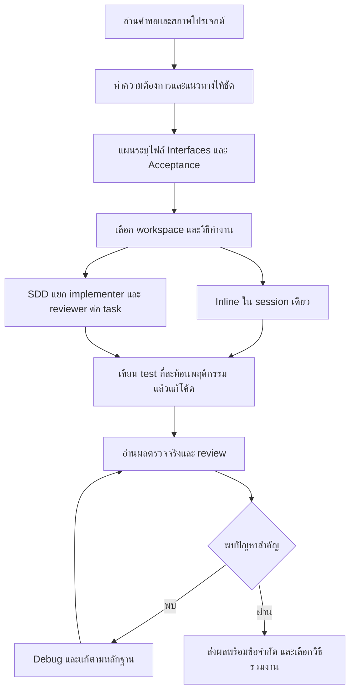

# ตรวจสอบ Superpowers และแนวทางใช้กับ Football Prediction AI

ตรวจวันที่ **27 ตุลาคม 2026 — Asia/Bangkok** จาก repository จริงผ่าน GitHub connector และตรวจเอกสาร OpenAI Docs เรื่องการโหลด skills โดยงานนี้เป็นการอ่านและวิเคราะห์ ไม่ใช่การติดตั้ง Superpowers หรือเปิดใช้คำสั่งใน SKILL.md ที่นำมาตรวจ

## ข้อเสนอหลัก

**เหมาะใช้เพื่อทำให้การพัฒนาซอฟต์แวร์มีวินัย ตรวจสอบย้อนกลับ และลดข้อผิดพลาด โดยเริ่มจาก workflow ที่ปรับตามโปรเจกต์เรา** ประโยชน์ที่ตรงที่สุดคือ debugging, verification, review และแผนที่ระบุ acceptance criteria ชัดเจน ส่วนการรับรองความแม่นยำทายฟุตบอลต้องอาศัยข้อมูลและการประเมินทางสถิติของเราเช่นเดิม

แนะนำทำงานใน session เดียวเป็นค่าเริ่มต้น ใช้ subagent เฉพาะงานที่ได้รับอนุญาตและแยกกันได้จริง รักษาการอนุมัติที่ผู้ใช้ให้ไว้แล้ว และไม่ถามยืนยันซ้ำกับงานที่ชัดเจนภายในขอบเขตเดิม การออกแบบใหม่ที่มีผลต่อสถาปัตยกรรมยังควรแสดงทางเลือกและเหตุผลก่อนลงมือ

## 1. รุ่นและหลักฐานที่ตรวจ

| รายการ | ผลตรวจ |
|---|---|
| ต้นทาง | `obra/superpowers` |
| HEAD ที่ตรึงในการตรวจ | `2ce8aa15d05bd57213e6f746f953aafb7ded7a8b` |
| รุ่นใน manifest ต้นทาง | **7.0.1** |
| latest release ที่ API ส่งกลับ | `v7.0.1`, เผยแพร่ 21 ต.ค. 2026 21:05:11 UTC |
| Repository tree | 231 ไฟล์; tree response ไม่ถูกตัด |
| Skills ต้นทาง | **15** |
| ไฟล์ต้นทางที่ดึงและตรวจ Git blob hash | **42 ไฟล์** รวม 15 SKILL.md, manifests, hooks, helpers, runtime adapters และเอกสารสำคัญ |
| แพ็กเกจใน `openai/plugins` ที่ตรวจ | manifest **6.3.0**, **14 skills** |
| Commit ของ marketplace ที่ตรึง | `0722921d5542fc593105c27bd52630babd8b8c2a` |
| Official marketplace skill bodies ที่เทียบเพิ่ม | `brainstorming`, `executing-plans` |
| License | MIT |

ต้นทางกับ marketplace **ไม่ใช่ snapshot รุ่นเดียวกัน** และรุ่นใน public marketplace repository ไม่รับรองว่าบัญชีหรือแอปของผู้ใช้เสนอ/ติดตั้งรุ่นนั้นอยู่ ต้องดูรุ่นจริงอีกครั้งก่อนเลือกวิธีใช้

ต่างกันในเนื้อหาด้วย:

- `executing-plans` ของ marketplace 6.3.0 แนะนำไป SDD หากมีเครื่องมือ subagent ขณะที่ต้นทาง 7.0.1 รองรับการเลือก inline execution ใน session เดียวอย่างชัดเจน
- `brainstorming` ของ 6.3.0 กำหนด approval gate ทุกเส้นทาง ขณะที่ 7.0.1 มีทางทำงานเล็กที่ข้อมูลครบได้โดยตรง และเส้นทาง opt-out จากการถาม
- `diagnosing-superpowers` มีในต้นทาง 7.0.1 แต่ไม่อยู่ในรายการ skills ของแพ็กเกจ 6.3.0 ที่ตรวจ

หลักฐาน: [release](https://github.com/obra/superpowers/releases/tag/v7.0.1), [manifest ต้นทาง](https://github.com/obra/superpowers/blob/2ce8aa15d05bd57213e6f746f953aafb7ded7a8b/.codex-plugin/plugin.json), [manifest marketplace](https://github.com/openai/plugins/blob/0722921d5542fc593105c27bd52630babd8b8c2a/plugins/superpowers/.codex-plugin/plugin.json), [executing-plans 6.3.0](https://github.com/openai/plugins/blob/0722921d5542fc593105c27bd52630babd8b8c2a/plugins/superpowers/skills/executing-plans/SKILL.md)

รายการไฟล์และ SHA-256 อยู่ใน [source-manifest.json](../reports/superpowers-audit/source-manifest.json) เก็บสำเนา source สำหรับตรวจเป็น JSON ใต้ `data/source/superpowers-audit/` ซึ่งไม่ใช่ตำแหน่งโหลด skills อัตโนมัติ ไม่มีการรัน scripts ของต้นทาง

## 2. ระบบนี้ประกอบด้วยอะไร

| ส่วน | หน้าที่ |
|---|---|
| `skills/*/SKILL.md` | คำสั่งกระบวนการทำงานและเงื่อนไขเลือกใช้ เป็นส่วนสำคัญที่สุด |
| `references/`, reviewer/implementer templates | รายละเอียดเครื่องมือ เกณฑ์ตรวจ และ brief ส่งงาน |
| Git/SDD helper scripts | สร้าง workspace เฉพาะแผน, แยก task brief, ทำ diff package และบันทึกความคืบหน้า |
| Platform manifests/adapters | ทำให้ agent แต่ละตัวพบ skills และรับ bootstrap ตามวิธีของ platform |
| Visual companion | Node HTTP/WebSocket server สำหรับ mockup/diagram ระหว่างออกแบบ |
| `tests/` | ตรวจ infrastructure และ helpers ของ plugin |
| Behavioral eval lab | ตรวจว่าตัว coding agent ทำตาม workflow จริงหรือไม่ โดยรัน LLM sessions แยกต่างหาก |

Superpowers ใช้เครื่องมือของ coding agent ที่มีอยู่ เช่น อ่าน/เขียนไฟล์ shell Git และ subagent ไม่ได้เพิ่มข้อมูลฟุตบอล น้ำหนักโมเดล หรือ runtime สำหรับให้เว็บทำงานต่อเมื่อปิดเครื่องส่วนตัว ระบบ Cloudflare/GitHub Actions ที่เตรียมไว้ยังต้องจัดการแยกตามแผนของเรา

การติดตั้งอยู่ที่เครื่องมือพัฒนา จึงไม่ต้องเพิ่ม Superpowers เป็น dependency ใน React, Worker, `package.json` หรือ `requirements.lock` ของแอปฟุตบอล

เอกสาร OpenAI อธิบายว่า Codex โหลดชื่อ/description ก่อน แล้วจึงอ่าน SKILL.md เมื่อเลือกใช้ มีทั้ง explicit และ implicit invocation และรองรับ `.agents/skills` ระดับโครงการหรือผู้ใช้ ดังนั้น description ที่กว้างมากย่อมมีโอกาสถูกเรียกบ่อย การมี skill ในเครื่องไม่ได้ทำให้คำสั่งของมันกลายเป็น authorization ที่เหนือกติกาโครงการ ดู [Build skills — OpenAI Docs](https://learn.chatgpt.com/docs/build-skills)

## 3. ลำดับการทำงาน

นี่คือภาพรวมของ workflow ไม่ได้แปลว่าทุกคำถามเล็กต้องสร้างเอกสารและเปิด agent หลายตัว ขนาดงาน การอนุมัติที่มีแล้ว และกติกาของ platform ต้องถูกนำมาพิจารณา

SDD ต้นทางทำ implementer ทีละ task ไม่เปิด implementer หลายตัวแก้ร่วมกันโดยอัตโนมัติ `dispatching-parallel-agents` เป็นอีก workflow สำหรับปัญหาที่เป็นอิสระจริง ส่วน fix loop จำกัดห้ารอบ ใช้ implementer เดิมในรอบต้น และเปลี่ยนผู้ทำ/เพิ่มความสามารถในรอบหลัง จากนั้น controller ต้องตัดสินและบันทึก finding ที่ยังเหลือ

## 4. Skills ทั้ง 15 และความเหมาะสมกับเรา

| Skill | การทำงาน | แนวทางใช้กับ Football AI |
|---|---|---|
| `using-superpowers` | เลือก skill ก่อนเริ่มงาน มี trigger กว้างและกติกาบังคับอ่าน | ปรับการเลือกให้ตรงงาน ไม่เปิด bootstrap กว้างกับทุกบทสนทนา |
| `brainstorming` | ทำความเข้าใจเหตุผล ขอบเขต ทางเลือก และ design | ใช้กับ subsystem/สถาปัตยกรรมใหม่ งานที่มี spec และอนุมัติแล้วให้ทำต่อ |
| `writing-plans` | แผนมีไฟล์ signatures, interfaces, constraints, tests และผลที่คาด | มีประโยชน์มากกับ pipeline/API/ML ที่เชื่อมกันหลายส่วน |
| `executing-plans` | ทำแผนต่อเนื่อง เก็บ ledger และหลักฐานใน session เดียว | เป็นแนวทางหลักที่แนะนำ โดยตรวจความต่างระหว่างรุ่น |
| `subagent-driven-development` | implementer ต่อ task, review spec/quality และ final review | ใช้เมื่ออนุญาตและงานซับซ้อนคุ้มกับ context/review เพิ่ม |
| `dispatching-parallel-agents` | แยกปัญหาอิสระทำพร้อมกัน | เหมาะกับการตรวจคนละส่วน หลีกเลี่ยงผู้แก้ไฟล์หรือ D1 เดียวกันพร้อมกัน |
| `test-driven-development` | RED → GREEN → REFACTOR ทดสอบพฤติกรรมก่อนแก้ | เหมาะกับ bug/logic ใหม่ เช่น cutoff, quota และ normalization ต้องปรับข้อบังคับที่กว้างเกินงาน |
| `systematic-debugging` | reproduce → trace ต้นเหตุ → ตั้งสมมติฐาน → แก้และพิสูจน์ | แนะนำใช้ก่อนกับ data mismatch, stale fixture, API/D1 และผลทำนายผิดปกติ |
| `verification-before-completion` | ต้องมี command/output/exit code รองรับการกล่าวว่าสำเร็จ | แนะนำมาก ผูกหลักฐานกับ code/dataset/model version ที่ตรวจ |
| `requesting-code-review` | เตรียม requirement และ diff ให้ reviewer ตรวจ | ใช้ก่อนรวมงานสำคัญ เลือก human/agent review ตามสิทธิ์และงบ |
| `receiving-code-review` | ตรวจว่าคำแนะนำถูกกับโค้ดจริงก่อนแก้ | ใช้ได้ทันทีในหลักการ โดยรักษางานอิสระที่ยังทำต่อได้ |
| `using-git-worktrees` | ตรวจ isolation ใช้ native tool ก่อน fallback Git | ต้องมี Git repo ก่อน แยก environment/D1 และ source setup ให้ถูก |
| `finishing-a-development-branch` | ตรวจผล เลือกเก็บ branch/merge/PR และ cleanup | เหมาะหลังมี Git ห้าม cleanup ทำลายหลักฐาน/ข้อมูลเฉพาะเครื่อง |
| `writing-skills` | ออกแบบและทดลอง skill กับสถานการณ์จริง รวม baseline/control | ใช้ภายหลังเมื่อมี workflow ซ้ำและพิสูจน์ว่าคำสั่งเดิมยังไม่พอ |
| `diagnosing-superpowers` | อ่าน transcript ตรวจ skill timeline, แผน, งานซ้ำ, คุณภาพ, เวลา/โควตา | ใช้เมื่อต้องตรวจ session ที่ผิดปกติ ระวังข้อมูลใน transcript และค่าใช้จ่ายจาก analyst หลายตัว |

Skills สองตัวที่แนะนำเป็นแกนแรกคือ [systematic-debugging](https://github.com/obra/superpowers/blob/2ce8aa15d05bd57213e6f746f953aafb7ded7a8b/skills/systematic-debugging/SKILL.md) และ [verification-before-completion](https://github.com/obra/superpowers/blob/2ce8aa15d05bd57213e6f746f953aafb7ded7a8b/skills/verification-before-completion/SKILL.md) ส่วน review ช่วยตรวจความสอดคล้องกับหลักฐานมากกว่าการเพิ่มขั้นตอนเพื่อให้ดูครบ

## 5. การรองรับเครื่องมืออื่น

README มีวิธีติดตั้งสำหรับ Claude Code, Antigravity, Codex App/CLI, Cursor, Devin CLI, Factory Droid, Gemini CLI, GitHub Copilot CLI, Grok Build CLI, Kimi Code, OpenCode, Pi, Qwen Code, Hermes และ Muse ต้องติดตั้งแยกตาม harness แม้ใช้ repository เดียวกัน

กลไกสำคัญต่างกัน:

- Claude Code และบาง harness ใช้ SessionStart hooks อ่าน `using-superpowers` แล้วส่งบริบทเข้า agent มี wrapper `.cmd`/Bash สำหรับ Windows
- **Codex manifest ที่ตรวจมี `skills: ./skills/` และ `hooks: {}`** จึงไม่ควรนำคำอธิบาย Claude SessionStart มาอ้างว่า Codex รัน shell hook เดียวกันทุกครั้ง การเลือก skills ขึ้นกับการโหลดและ invocation ของ Codex
- OpenCode มี JavaScript adapter สำหรับรูปแบบเครื่องมือ/บริบทของ OpenCode
- Pi มี TypeScript extension ที่ใส่ bootstrap กลับหลัง compaction
- Hermes มี Python registration และ `pre_llm_call` hook; README ระบุข้อจำกัดเมื่อ session ยาวจนบริบทต้นถูก compact
- Muse มี manifest ระบุ skills และ SessionStart hook ของตนเอง

การรองรับใน README เป็นข้อมูลจากผู้พัฒนา การตรวจครั้งนี้ไม่ได้รันทุก harness หรือรับรองว่าทุก integration ใช้งานได้บนเครื่องนี้

## 6. ส่วนที่ช่วยโปรเจกต์เราได้จริง

### Data pipeline และ identity

ใช้ root-cause tracing ตรวจเส้นทาง response → normalizer → mapping → observation → accepted dataset → features แทนการแก้ค่าที่ปลายทางเพื่อให้จำนวนแถวดูครบ การ review ต้องถามว่า missing score ยังเป็น null หรือไม่, `score.ft`/array ถูกแปลตรงกันหรือไม่, วันที่ขัดกันถูกกักหรือไม่ และชื่อทีมใหม่มีหลักฐานเพียงพอหรือไม่

ไฟล์เป้าหมาย: `ml/live/normalize.py`, `ledger.py`, `ml/config/provider_identity_v1.json` และชุดทดสอบ `ml/tests/test_live_research.py`

### โควตา/API/D1

ให้แต่ละ task ระบุผลต่อ broker ชัดเจน เช่น reserve ก่อน transport, settle ซ้ำไม่เพิ่มการใช้, stale response ไม่เพิ่มโควตากลับ, query ที่รู้ว่าไม่รองรับไม่ถูกเรียกจริง ทดสอบด้วย mock transport และ isolated D1 ได้โดยไม่ใช้ API จริง การใช้ generic retry ตัวอย่างใน skill ต้องไม่ทำให้โปรเจกต์เริ่ม retry provider โดยข้ามนโยบายโควตา

ไฟล์เป้าหมาย: `apps/api/provider.ts`, `provider-broker.ts`, `ml/provider_broker.py`, `ml/provider_policy.py`, `tests/provider-broker.test.ts`

### เวลาและคำทำนายก่อนแข่ง

Review ต้องตามข้อมูลตั้งแต่ `first_seen_at` ถึง `generated_at` และ kickoff ไม่ดูแค่เวลาแข่งในหน้าจอ ตรวจรอบวันไทยแบบ `[06:00, 06:00 ถัดไป)`, competition date/timezone, reschedule occurrence, ผล 90 นาที และการแก้ผลเป็น revision ตัวอย่างหลังแข่งต้องไม่กลายเป็น feature ก่อนเกมเดียวกัน

ไฟล์เป้าหมาย: `ml/live/predict.py`, `context.py`, `evaluate.py`, migrations `0006`–`0010` และ `packages/football/window.ts`

### คุณภาพ ML

Tests ที่ผ่านพิสูจน์ว่า logic ทำงานตามเงื่อนไขที่ตรวจ ส่วนความแม่นยำต้องพิสูจน์ด้วย temporal validation/holdout/prospective data แยกต่างหาก จึงห้ามเอาเป้า 70–80% มาเขียนเป็น test ที่คอยปรับ threshold หรือเลือกลีกจากผล final test จนผ่าน

กติกาของเราต้องเหนือ workflow ทั่วไป: freeze protocol ก่อนทดสอบ, บันทึก dataset/model/feature/cutoff/checksum, ไม่แก้ artifact เดิม และไม่เลื่อนโมเดลเมื่อ statistical gate ยังไม่ผ่าน แม้ code review จะมองว่าโค้ดสะอาดแล้วก็ตาม

สถานะอ้างอิงล่าสุดจากรายงานวันที่ 26 ต.ค. มี accepted research 17,043 นัด แต่ API-rich prospective training readiness ยังเป็น 0 ตัวอย่างที่ใช้ได้ การติดตั้ง Superpowers จะไม่เปลี่ยนสถานะนี้เอง งานตรวจวันนี้ไม่ได้ refresh ฟุตบอลหรือประเมิน accuracy ใหม่

### หน้าจอและสรุปรายวัน

แผนที่มี acceptance ชัดช่วยทดสอบว่าเลือกลีกแล้วคู่ไม่ข้ามลีก, H2H league/all ไม่ปนกัน, ไม่มี snapshot ก็แสดงไม่มีข้อมูล, และชุด 3/5 คู่ไม่เติมขาให้ครบ ทั้งยังตรวจ desktop/mobile และ URL deep link ได้ โดย mock UI ต้องมีป้าย/ขอบเขตการทดสอบแยกจากหลักฐานผลบอลจริง

ไฟล์เป้าหมาย: `apps/web/src/ProviderPreview.tsx`, `LiveDetail.tsx`, `packages/football/selection.ts`, `tests/ui/live-detail.spec.ts`, `live-forecast.spec.ts`

## 7. จุดที่ต้องปรับก่อนใช้ทั้งชุด

| พฤติกรรมต้นทาง | ผลต่อเรา | ข้อกำหนดที่แนะนำ |
|---|---|---|
| `using-superpowers` ให้พิจารณา skill แม้ความเกี่ยวข้องน้อยมาก | เพิ่มการอ่านบริบทและอาจเรียก workflow เกินงาน | เลือกเฉพาะ skill ที่สัมพันธ์กับงานจริง และเริ่มจาก project scope |
| Approval gates หลายชั้น | อาจถามซ้ำหลังผู้ใช้อนุมัติให้ทำต่อแล้ว | ใช้ authorization ที่มีอยู่ งานชัดเจนให้ทำต่อ ถามเมื่อมีตัวเลือกสำคัญที่ยังไม่ถูกตัดสิน |
| TDD มีข้อความให้ลบโค้ดที่เขียนก่อน test | ไม่เหมาะกับการย้อนลบระบบ/โมเดล/หลักฐานเดิมที่มีอยู่ | ใช้ test-first กับการเปลี่ยนใหม่ ไม่รื้อของเดิมเพื่อทำพิธีให้ครบ |
| ทุก task อาจชวน run full suite | ML training/backtest แพงและ final holdout ไม่ใช่ test วนแก้ | แยก software regression ออกจาก model evaluation และห้าม retune บน holdout |
| Inline ต้นทางยัง dispatch final reviewer หากมี tool | ชื่อ inline ไม่รับรองว่าใช้ agent เดียวตลอด | กำหนด single-agent/human review ให้ชัดเมื่อยังไม่ได้อนุญาต subagent |
| SDD/diagnosing ใช้ผู้ทำและผู้ตรวจหลายบริบท | ใช้ token/โควตาเพิ่ม มีโอกาสตรวจซ้ำ | จำกัดขอบเขต ใช้เฉพาะเมื่อคุ้ม ส่ง brief/file paths และหลักฐานที่ตรวจแล้ว |
| Model/tool examples ใน Codex reference | อาจไม่ตรง tool schema/allowlist ปัจจุบัน | ยึดเครื่องมือและข้อกำหนด runtime จริง ไม่เปลี่ยน config หรือโมเดลตามตัวอย่างอัตโนมัติ |
| Worktree setup ตัวอย่าง `npm install`/`requirements.txt` | เราใช้ lockfiles และ `.venv`; อาจขาด Python deps หรือเปลี่ยน lock | ใช้ `npm ci`, Python ของ environment ที่กำหนด และ `requirements.lock` |
| New worktree ไม่ได้มี ignored data/`.venv`/local D1 อัตโนมัติ | รัน pipeline ไม่ได้ หรือไปแตะฐานผิดแห่ง | Restore source ที่ pin, setup environment และใช้ isolated local D1/mock ก่อน |
| Workspace/ledger ของแผนถูก cleanup เมื่อจบ | หลักฐานสำคัญอาจหายไปพร้อม scratch | เก็บผลสรุป คำสั่ง exit code code/dataset/model hash ที่ต้องใช้ไว้ใน reports ก่อน cleanup |
| Fix-loop breaker อนุญาตให้ตัดสิน/park findings | ห้ามใช้เป็นทางข้าม data/ML acceptance | Leakage, secret exposure, cutoff/identity ผิด และ gate ไม่ผ่านยังเป็น blockers |
| `receiving-code-review` ให้หยุดทั้งหมดหากบางข้อไม่ชัด | อาจขัดกับการทำงานส่วนอิสระต่อ | ชี้ส่วนที่รอคำตอบ และทำส่วนที่ไม่ขึ้นกับคำตอบต่อภายในขอบเขตที่อนุมัติ |

ข้อความใน skill เป็นแนวทางให้ agent ทำตาม ไม่ใช่กลไกความปลอดภัยที่รับประกันผล ฐานข้อมูล immutable triggers, authorization, allowlist, quota enforcement และ automated checks ของเรายังจำเป็น Worktree แยก Git working files แต่ไม่ได้เป็น secret sandbox โดยตัวมันเอง

## 8. สภาพเครื่องและโปรเจกต์ที่ตรวจจริง

- `D:\Football Prediction AI` **ยังไม่เป็น Git repository** จึงยังใช้ branch/worktree/PR และ helpers ที่อาศัย `git rev-parse` ไม่ได้ การใช้หลัก debugging/verification ยังเริ่มได้โดยไม่ต้องรอ Git
- มี Git for Windows และ `C:\Program Files\Git\bin\bash.exe` อยู่จริง แต่ Bash ไม่ได้ถูกพบเป็นคำสั่งบน PATH ใน PowerShell ขณะตรวจ จึงต้องแยก syntax PowerShell/Bash และ quote path ที่มีช่องว่างให้ถูก
- ยังไม่มี `D:\Football Prediction AI\.agents\skills` หรือ user skill folder ชื่อ `superpowers` ที่ตำแหน่งซึ่งตรวจ ไม่ใช่หลักฐานยืนยันว่าไม่มี plugin cache/installation ในทุกตำแหน่งหรือทุกบัญชี
- บริบท chat ปัจจุบันเริ่มจาก `D:\Live score Project` ขณะที่โค้ดใหม่อยู่คนละโฟลเดอร์ ก่อนใช้ project-scoped skill ต้องเปิด workspace ของ `D:\Football Prediction AI` ให้ถูก การตั้ง `workdir` ให้คำสั่งเดียวไม่ใช่การย้าย project ของทั้ง chat
- รายงานเดิมระบุ Python 75, TypeScript/API 48, browser 7 ผ่าน รวม 130 รายการ นี่เป็นหลักฐานรอบก่อน ไม่ได้รันใหม่ในงานเอกสารครั้งนี้

หลักฐานโครงการ: [AGENTS.md](../AGENTS.md), [verification เดิม](../reports/live-research/verification.json), [implementation เดิม](LIVE_RESEARCH_IMPLEMENTATION_TH.md), [frozen challenger protocol](../ml/config/live_challenger_v1.json)

## 9. วิธีนำมาใช้ที่แนะนำ

### ระยะแรก — ยืมหลักการและกำหนดให้เข้ากับโครงการ

1. เปิด workspace โปรเจกต์ใหม่ให้ถูก
2. เพิ่มกติกาสั้นใน AGENTS.md ของโปรเจกต์ใหม่ เมื่อเริ่มงานปรับ workflow จริง: scope, acceptance, debugging, verification, และข้อห้ามด้านข้อมูล/โมเดล
3. คงค่าเริ่มต้นทำงานใน session เดียว บันทึกแผน/ความคืบหน้าเป็นไฟล์เมื่อเป็นงานหลายขั้น และระบุกรณีที่ต้อง independent review
4. ใช้ upstream ที่ pin ไว้เป็น reference หากจะทำ local skill ให้เก็บ references/scripts ที่จำเป็นครบ ไม่คัด SKILL.md เดี่ยว ๆ แล้วปล่อยลิงก์หรือ required sub-skills ขาด
5. หากดัดแปลง/แจกจ่ายเนื้อหาต้นทาง ต้องเก็บ MIT copyright/license notice ไว้

ระยะนี้ไม่ต้องนำ bootstrap ทั้ง 15 skills ไปใส่ใน global instructions และไม่ต้องแก้ production runtime

### หากเลือกใช้ plugin ทางการ

README ปัจจุบันให้ติดตั้งใน Codex App ผ่านหน้า Plugins ค้นหา **Superpowers** ส่วน Codex CLI ใช้ `/plugins` แล้วค้นหา/เลือก Install Plugin ต้องตรวจรุ่นและขอบเขตการทำงานของตัวที่แอปเสนอ และไม่สมมติว่าได้พฤติกรรม v7.0.1 จาก manifest marketplace 6.3.0 ที่ตรวจ

คำสั่ง Claude `/plugin install ...` เป็นของอีก harness ไม่ควรคัดมาใช้เป็นคำสั่ง Codex โดยตรง และไม่มีความจำเป็นต้อง `npm install superpowers` ในแอป React ของเรา

การติดตั้งแบบผูกเฉพาะ repo หรือ explicit-only skill ทำได้ตามกลไก local skills ของ Codex แต่เป็นงานติดตั้งอีกขั้นที่ต้องเลือกขอบเขตให้ชัด เอกสารนี้ยังไม่ได้สร้าง `.agents/skills`, แก้ Codex config, เปิด multi-agent หรือเปลี่ยน AGENTS.md

## 10. งบ เวลา และ privacy

License MIT อนุญาตให้ใช้/ดัดแปลงตัวโค้ดได้โดยไม่มีค่า license บังคับ ส่วน coding agent ยังใช้ token/โควตาของแพลนเดิม การมีหลาย implementer/reviewer และการทำ fix loop ทำให้ใช้บริบทเพิ่ม จึงควรวัดจากงานจริง ไม่สรุปว่าเร็วขึ้นหรือประหยัดกี่เปอร์เซ็นต์จากคำโฆษณา

Visual companion เป็นเครื่องมือเสริมที่เปิด local server ค่าเริ่มต้น bind `127.0.0.1` ใช้ session token และตรวจการเข้าถึงใน source ที่อ่าน มีการโหลดรูปโลโก้จาก `primeradiant.com` พร้อม version โดยค่าเริ่มต้นเมื่อใช้ companion ปิดได้ด้วย `SUPERPOWERS_DISABLE_TELEMETRY=1` ค่านี้ปิดการโหลดเพื่อ telemetry ที่ตรวจพบ ไม่ใช่สวิตช์ปิด network ทุกประเภท

ไม่พบ project/prompt payload ใน URL โลโก้ส่วนที่อ่าน แต่ browser ยังคงส่งข้อมูลการเชื่อมต่อมาตรฐานเมื่อขอรูป การตรวจแบบ static นี้ไม่ใช่คำรับรองด้าน privacy หรือ security ทั้งระบบ Logs/server-info ของ companion มี session key จึงไม่ควร commit `.superpowers/brainstorm/` หรือใส่ credential ลง mockup

`diagnosing-superpowers` อ่าน transcript และมีขั้นตอน scrub/issue/export ซึ่งเกี่ยวข้องกับประวัติคำสั่งและผลลัพธ์ของเครื่อง ต้องจำกัด session/ช่วงเวลาที่ตรวจ และตรวจข้อมูลก่อนส่งภายนอก การมี redaction workflow ไม่รับรองว่าจะปิดข้อมูลสำคัญได้หมด การตรวจวันนี้ไม่ได้อ่าน transcript ของผู้ใช้หรือสร้าง GitHub issue/comment

เอกสาร testing ของต้นทางแยก infrastructure tests ออกจาก live LLM evals ซึ่งอาจใช้เวลาและโควตาจริง จึงไม่ได้รัน live evals ในงานตรวจนี้ [Testing Superpowers](https://github.com/obra/superpowers/blob/2ce8aa15d05bd57213e6f746f953aafb7ded7a8b/docs/testing.md)

## 11. ตัวอย่างนำร่องและเกณฑ์ตัดสิน

นี่คืองานตัวอย่างที่เสนอสำหรับรอบถัดไป ไม่ใช่รายงานว่าพบ bug แล้ว และยังไม่ได้ลงมือเปลี่ยนโค้ด:

| ตัวอย่างงาน | สิ่งที่พิสูจน์ | ขอบเขตที่ควรล็อก |
|---|---|---|
| เพิ่ม regression รอบเวลา/DST และ 06:00 | timezone/cutoff ไม่เลื่อนคู่ข้ามวันผิด | ใช้ fixtures ใน test ไม่เรียก API |
| ตรวจ archive pagination ที่ขอบ 20 แถว/80 KB | hydrate ไม่ซ้ำ ไม่ข้ามแถวและตรวจ hash | isolated D1 และข้อมูลจำลอง |
| เพิ่มทีมที่มี fixture ใหม่อย่างมีหลักฐาน | ไม่มี fuzzy identity merge ที่เดาเอง | mapping หนึ่งชุด; ไม่แก้ข้อมูลเดิมเงียบ ๆ |
| ปรับการแสดงอายุ source ต่อกลุ่มข้อมูล | ผู้ใช้แยก stale/unknown/complete ได้ | UI + API contract; ไม่เปลี่ยนคะแนนโมเดล |
| เพิ่มกรณี prospective evaluation แรกที่ settled | denominator, calibration, pending/void ถูกต้อง | ไม่ใช้ผลจำลองเป็น accuracy จริง |

ทุกงานบันทึกเวลา จำนวน clarification รอบ token/usage ที่วัดได้ จำนวนงานซ้ำ และผล regression เปรียบเทียบกับงานที่ใกล้เคียงกัน การตัดสินใช้จริงควรมองว่าได้คุณภาพเพิ่มโดยไม่เพิ่มภาระที่ไม่คุ้ม ไม่ตั้งเปอร์เซ็นต์ปรับปรุงล่วงหน้าโดยไม่มีผลทดลอง

เงื่อนไขบังคับของเรา: ไม่มี credential ใน source/log ที่ส่งต่อ, ไม่มี production/paid side effect, tests ไม่เรียก provider จริงเอง, ไม่มีคำทำนายหลัง kickoff, ไม่ลด quarantine เพื่อให้จำนวนครบ, ไม่แก้ threshold จาก holdout, ไม่แตะ frozen artifacts และ `MODEL_AUTO_PROMOTE=false` คงเดิม หากข้อใดไม่ผ่านต้องรายงานเป็น gap แม้ workflow ภายนอกจะจบ task แล้ว

## 12. สิ่งที่ส่งมอบและขอบเขตการตรวจ

- เอกสารนี้สรุปกลไกทั้ง 15 skills, platform integration, จุดต่างของเวอร์ชัน และแผนใช้ที่สัมพันธ์กับโค้ดของเรา
- `reports/superpowers-audit/source-manifest.json` เก็บ commit และ hashes ที่ใช้ตรวจ
- `reports/superpowers-audit/adoption-plan.json` เป็นข้อเสนอที่ยังไม่ถูกนำไปเปิดใช้
- สำเนา source ใน ignored audit cache เป็นข้อมูลประกอบการตรวจ ไม่ใช่ installation

งานนี้ไม่ได้แก้แอป, ฐานข้อมูล, น้ำหนัก/เกณฑ์โมเดล, Git config, global skills หรือโปรเจกต์เดิม และไม่ได้เรียก API-Football ไม่ได้ทดสอบทุก platform แบบ live ผลตรวจจึงใช้ตัดสินแนวทางนำมาใช้และออกแบบ pilot ได้ แต่ยังไม่ใช่คำรับรองประสิทธิภาพหรือความเข้ากันได้จริงหลังติดตั้ง
