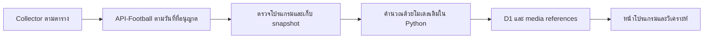

# แผนทำ Football Prediction AI ให้ใช้งานได้ง่าย

วันที่ 27 ตุลาคม 2026 — Asia/Bangkok

สถานะ: **แผนก่อนลงมือพัฒนา** งานรอบนี้อ่านโค้ด ตรวจหลักฐานที่มี และจัดทำแผน ยังไม่แก้แอป/ฐานข้อมูล/โมเดล ไม่เรียก API-Football เพิ่ม และไม่ deploy

## 1. เป้าหมายของรอบนี้

เปิดเว็บแล้วเห็นคู่ที่กำลังจะเตะ แยกลีกและเวลาไทย มีโลโก้ กดคู่เพื่อดูประวัติและการวิเคราะห์ได้ง่าย ใช้งานได้ดีบนมือถือและคอมพิวเตอร์ ใช้โมเดลที่ฝึกไว้แล้วกับ fixture อนาคตที่ข้อมูลพร้อม ส่วนโมเดลเสริมรุ่นใหม่เป็นงานสะสมข้อมูลต่อไป

ขอบเขตเริ่มต้นคือ Premier League, La Liga, Bundesliga, Serie A และ Championship ใช้ React/TypeScript + Worker/D1 + Python เดิม ใน `D:\Football Prediction AI` โปรเจกต์ `D:\Live score Project` คงเดิม

ค่าเริ่มต้นด้านการออกแบบที่เสนอ: ภาษาไทย, ธีมเข้มเดิมที่ปรับให้อ่านง่าย, เน้นมือถือ, ใช้งานส่วนตัวก่อน และเก็บเครื่องมือวิจัยไว้ในเมนูรอง

## 2. สิ่งที่ตรวจพบแล้ว

- มีหลักฐานว่า date endpoint เคยส่ง fixture ที่ยังไม่เริ่มจริง: snapshot รับเมื่อ 26 ต.ค. 01:54 ไทย มี Udinese–AC Milan เวลา 02:45 และ Barcelona–Real Madrid เวลา 03:00
- หลักฐานนี้ยืนยันตัวอย่างการดึงก่อนแข่ง แต่ยังไม่ใช่สิทธิ์ดึงล่วงหน้าทุกช่วง เช่น 7/14/30 วัน วันที่ 27 ต.ค. เคยถูกปฏิเสธเมื่อทดสอบในรอบก่อน จึงต้องใช้ช่วงวันที่ที่บัญชีอนุญาตจริง ณ ตอนเริ่มใช้งาน
- Raw response มี URL โลโก้อยู่แล้วใน `league.logo`, `teams.home.logo`, `teams.away.logo` ตัวอย่าง host คือ `media.api-sports.io`
- Normalizer ปัจจุบันยังไม่ได้ส่งข้อมูลรูปเหล่านี้ไปให้หน้าเว็บ การเพิ่มชั้นข้อมูลสำหรับแสดงผลจึงเป็นงานหลักที่ต้องทำ
- หน้าแรกปัจจุบันเปิดที่คู่จำลองและมีเมนูวิจัยหลายรายการ ควรเปลี่ยนให้โปรแกรมจริงเป็นจุดเริ่มต้น
- Backend มีรอบ 06:00–06:00, immutable prediction, history/H2H, quota broker และ signed import อยู่แล้ว ใช้ของเดิมเป็นฐานได้

อ้างอิงการทดสอบบัญชีครั้งก่อน วันนี้ยังไม่ได้ตรวจสิทธิ์บัญชีสดหรือโหลดรูปจาก CDN เพิ่ม

## 3. หน้าหลักและเส้นทางผู้ใช้

มีเมนูหลักสามรายการ: **โปรแกรม / คู่เด่น / ผลการทำนาย** และเมนูรอง **ข้อมูลวิจัยและระบบ** สำหรับผลย้อนหลัง คุณภาพข้อมูล ตัวอย่างจำลอง และรายละเอียดโมเดล

### โปรแกรม

- เปิดมาแสดงรอบปัจจุบันตามเวลาไทย โดยหนึ่งวันเป็น `[06:00, 06:00 วันถัดไป)`
- ปุ่ม วันนี้ / พรุ่งนี้ / เลือกวัน พร้อมบอกช่วงวันที่ที่มีข้อมูลจริง วันอนาคตที่ยังไม่ทราบสิทธิ์แสดงสถานะตรงไปตรงมา
- ตัวกรอง คืนนี้ / ทั้งรอบ, ลีก, ชื่อทีม และสถานะแข่ง
- แสดงลีกเป็นกลุ่ม มีโลโก้ลีกและจำนวนคู่ เรียงเวลาแข่งภายในลีก
- การ์ดแต่ละคู่มีโลโก้ทีม ชื่อทีม เวลาไทย สถานะ และปุ่มดูวิเคราะห์
- เริ่มจากคู่ยังไม่เตะ โดยยังเปิดดูคู่ที่กำลังแข่ง/จบแล้วได้ ไม่เสนอว่าเป็น livescore แบบวินาทีต่อวินาที
- แสดงเวลาอัปเดตข้อมูลให้เห็นใกล้ตัวกรอง ไม่วาง banner ขนาดใหญ่จนคู่แข่งขันหลุดจากหน้าจอแรก

ภาพร่างโครงสร้าง:

```text
สนามข้อมูล                     อัปเดตล่าสุด …
[โปรแกรม] [คู่เด่น] [ผลการทำนาย]

[วันนี้] [พรุ่งนี้] [เลือกวัน]   [คืนนี้]
[ทุกลีก ▼]   [ค้นหาทีม …]
รอบ 06:00 วันนี้ → 06:00 พรุ่งนี้

[โลโก้ลีก] Premier League          … คู่
  [โลโก้] ทีมเหย้า  —  ทีมเยือน [โลโก้]
           เวลาไทย …     [ดูวิเคราะห์]

[โลโก้ลีก] La Liga                 … คู่
  …
```

### วิเคราะห์รายคู่

กดคู่แล้วเข้าสู่รายละเอียดที่มีลิงก์เปิดตรงได้ ปุ่มย้อนกลับและ browser Back กลับไปยังวัน/ลีก/ตำแหน่งเดิม บนมือถือแสดงเป็นหน้าอ่านเต็มพื้นที่ บนคอมจัดข้อมูลเป็นสองคอลัมน์ได้ โดยใช้ข้อมูลและ logic ชุดเดียวกัน

ลำดับเนื้อหา:

1. โลโก้/ชื่อทีม ลีก เวลาแข่ง และสถานะ
2. สรุปโมเดลเรา: เหย้า–เสมอ–เยือน, ประตูคาดหมาย, สกอร์ที่เป็นไปได้ และสูง–ต่ำ พร้อมป้ายสั้นว่าเป็นโมเดลทดลอง
3. ฟอร์ม 5/10/20 นัด ค่าเฉลี่ยยิง/เสีย และแยกเหย้า–เยือน
4. H2H เลือกลีกเดียวกัน/ทุกรายการ พร้อมจำนวนข้อมูลที่มีจริง
5. ข้อมูลเสริม API ที่ได้รับทันเวลา เช่น ผู้เล่นขาด ตัวจริง และ xG จากเกมก่อน
6. Forecast ของ API แยกชื่อแหล่งข้อมูลชัดเจน
7. รายละเอียดแหล่งข้อมูล เวลา cutoff และข้อจำกัด เก็บในส่วนขยาย

คู่ที่ยังจับชื่อเข้าฐานย้อนหลังไม่ได้ยังดูโปรแกรม ชื่อ โลโก้ และเวลาได้ ส่วนการวิเคราะห์ระบุว่า “ข้อมูลวิเคราะห์ยังไม่พร้อม” พร้อมเหตุผลสั้น ๆ ไม่ต้องรอให้ทุกทีมผ่านเกณฑ์โมเดลจึงจะแสดงโปรแกรม

### คู่เด่น

- คู่ที่ผ่านเกณฑ์คัดของโมเดลเดิม
- อันดับประตูรวมคาดหมายและโอกาสสูง 2.5 จาก snapshot ที่มี พร้อมแยกจากคำว่าคู่ผ่านเกณฑ์
- คู่เดี่ยว และชุดทดลอง 3/5 คู่เมื่อมีจำนวนผ่านเกณฑ์พอ
- ถ้าคู่ไม่พอ ให้บอกจำนวนที่มีและไม่เติมคู่ให้ครบ
- ไม่ยกเปอร์เซ็นต์รายคู่ไปอ้างเป็นโอกาสถูกทั้งชุด

### ผลการทำนาย

- แยก รอแข่ง / รอผล / ถูก / ผิด / ยกเลิกการนับ
- แสดงจำนวนตัวอย่างและช่วงวันที่ที่วัด
- ผลก่อนแข่งจริงแยกจาก backtest และข้อมูลจำลอง
- หากยังไม่มีผลจริงให้แสดงสถานะเริ่มสะสม ไม่ใส่ค่า Accuracy ปลอม

## 4. โลโก้ทีมและลีก

ใช้ URL ที่มากับ API และผูกกับ provider ID โดยตรง ไม่เดาจากชื่อทีม ตัวอย่างที่พบ:

- `https://media.api-sports.io/football/leagues/39.png`
- `https://media.api-sports.io/football/teams/52.png`

เอกสารผู้ให้บริการระบุว่าการโหลดโลโก้/ธงจาก media CDN ไม่กิน daily API request quota แต่ CDN มี rate limits จึงควร cache ดู [คู่มือ API-Football](https://www.api-football.com/news/post/how-to-get-started-with-api-football-the-complete-beginners-guide)

แนวทางที่เสนอ:

- เพิ่ม reference metadata สำหรับทีม/ลีกและรูป โดยแยกจาก training identity และ observation เดิม
- เก็บไฟล์ภาพใน assets/cache ที่ใช้ได้กับโครงสร้างเดิม เก็บเฉพาะ reference/เวลาใน D1 ไม่เก็บ binary รูปลง D1
- รับเฉพาะ HTTPS host/path ของ provider ที่กำหนด ขนาดและชนิดไฟล์ต้องเหมาะสม ไม่ทำ arbitrary URL image proxy
- ไม่ส่ง API key ใน URL รูปหรือ browser
- แคชรูปตาม provider ID ใช้รูปเดิมต่อเมื่อ CDN ขัดข้อง และโหลดภาพเท่าที่จำเป็น
- กำหนดกรอบรูปคงที่ไม่ให้หน้ากระโดด มี fallback เป็นอักษรย่อ/สัญลักษณ์กลางเมื่อไม่มีภาพ
- ปรับ alt text ให้เหมาะกับชื่อทีมที่แสดงอยู่ข้างรูป และทดสอบ keyboard/screen reader

การเพิ่มรูปต้องไม่เปลี่ยน checksum/identity ของ accepted dataset หรือคำทำนายเดิมเพียงเพราะข้อมูลตกแต่งเปลี่ยน

## 5. ข้อมูลโปรแกรมและการอัปเดต

### ขั้นแรกเมื่อเริ่มลงมือ

ตรวจแบบจำกัดเฉพาะคำถามที่ต้องใช้: บัญชีอนุญาต date query ที่ครอบรอบวันนี้/คืนถัดไปถึงไหน และมี fixture ที่ kickoff หลังเวลารับข้อมูลหรือไม่ ไม่ต้องสำรวจทุก endpoint ใหม่

แยกผล “query ถูกอนุญาตแต่ไม่มีคู่” ออกจาก “ถูกปฏิเสธ” และ “ยังไม่ได้ดึง” การปฏิเสธวันอนาคตเมื่อวานไม่เป็นข้อห้ามถาวร สามารถตรวจใหม่แบบจำกัดเมื่อรอบวันของ provider เปลี่ยน

### การทำงานปกติ



- Browser อ่านฐาน/cache ของเรา การเปลี่ยนวัน/ลีก/เปิดรายละเอียดไม่เรียก provider โดยตรง
- คำสั่งรีเฟรชหน้าจออ่านข้อมูลล่าสุดที่ระบบเก็บไว้ ไม่เปิดช่องให้ผู้ชมใช้โควตา provider ได้ไม่จำกัด
- การอัปเดต provider เป็นงานของ collector ผ่าน quota broker กลาง
- ช่วงวันที่ query ครอบคลุมวันปฏิทิน แต่หน้าเว็บจัดกลุ่มใหม่เป็นรอบ 06:00–06:00 ต้องดึงสองวันปฏิทินสำหรับหนึ่งรอบ หากแสดงพรุ่งนี้ทั้งรอบอาจต้องวันปฏิทินที่สามเมื่อบัญชีอนุญาต
- เมื่อไม่ได้รับข้อมูลปลายรอบครบ ให้แจ้งว่าข้อมูลบางช่วงยังไม่พร้อม ไม่สรุปว่าไม่มีการแข่งขัน
- เก็บสถานะการดึงรายวันและเวลา: สำเร็จมีข้อมูล / สำเร็จว่าง / ถูกปฏิเสธ / ขัดข้อง / ยังไม่ดึง เพื่อให้ frontend แสดงถูกต้อง
- ดึงไม่สำเร็จให้ใช้ข้อมูลจริงที่เก็บล่าสุดพร้อมวันที่และสถานะ ห้าม fallback เป็นโปรแกรมจำลอง
- การทำนายทำก่อน kickoff เท่านั้น ข้อมูลที่ยังไม่พร้อมไม่ขัดขวางการดูโปรแกรม

งบออกแบบให้ใช้ broker เดิมที่จำกัดงานปกติ 65/day, เพดานงานสำคัญ 85/day และสำรอง 15 ไม่เปิด endpoint ใหม่โดยไม่มีเหตุผล งบตัวอย่างสำหรับตารางเดิม 8 รอบ/วัน: โปรแกรมสูงสุด 3 date requests/รอบ = 24, context เฉพาะคู่ที่ควรเก็บสูงสุด 3/รอบ = 24 และเผื่อเก็บผลย้อนหลังสั้น ๆ 2 รวมประมาณ 50 billable requests/day เมื่อทุกเส้นทางถูกใช้จริง ไม่จำเป็นต้องเรียกถึงเพดาน และต้องลด/ข้ามวันที่ที่ทราบว่ายังเข้าถึงไม่ได้

จำนวนนี้เป็นงบที่เสนอสำหรับ collector รุ่นปรับปรุง ไม่ใช่จำนวนคำขอที่รันในงานวางแผนนี้ และไม่ได้หมายถึงเก็บข้อมูลเสริมครบทุกแมตช์

## 6. ลำดับพัฒนาและไฟล์เป้าหมาย

| ระยะ | งาน | ไฟล์/ส่วนหลัก | ผลที่ต้องเห็น |
|---|---|---|---|
| 1. โปรแกรมอนาคต | ตรวจสิทธิ์เฉพาะ date ที่ใช้, สถานะการดึงรายวัน, แยก display identity จากความพร้อมโมเดล | `scripts/api_football_schedule.py`, `ml/live/normalize.py`, `ledger.py`, `pipeline.py`, `apps/api/live.ts` และ additive migration หากจำเป็น | โปรแกรมจริงที่ยังไม่เตะปรากฏได้ พร้อมบอกช่วงข้อมูลที่มี |
| 2. โลโก้และข้อมูลแสดงผล | Team/league references, media cache/fallback และ public DTO | migration ใหม่ต่อจาก `0010`, API media/reference module, `packages/football/types.ts` และ component รูป | โลโก้จริงขึ้นบนหัวลีก การ์ด และรายละเอียด รูปเสียไม่ทำให้หน้าเสีย |
| 3. หน้าหลักใช้ง่าย | โปรแกรมจริงเป็นค่าเริ่มต้น, สามเมนู, mobile cards, ค้นหา/ตัวกรอง/ลิงก์/Back | `App.tsx`, `ProviderPreview.tsx`, `LiveDetail.tsx`, CSS และ components ย่อย | เปิดเว็บเห็นโปรแกรมทันที ไม่ต้องผ่านหน้าวิจัยหรือคำสั่ง setup |
| 4. ครบวงจรบนเครื่อง | ทำนายคู่อนาคตที่พร้อม, สรุปคู่เด่น, ล็อกและแสดงผลภายหลัง | pipeline เดิม, `selection.ts`, API รายงาน/ผล และหน้า results | ใช้โปรแกรม → วิเคราะห์ → สรุป → ติดตามผลได้จริงตามข้อมูลที่มี |
| 5. คลาวด์เมื่ออนุมัติ | Git/repository, private access, D1, Secrets, collector schedule และสำรองหลักฐาน | workflow/Worker config และคู่มือเปิดใช้ | ทำงานได้เมื่อปิดคอม หลังผ่านการตรวจและอนุมัติ cloud rollout |

ระยะ 1–4 คือขอบเขตพัฒนาถัดไปที่เสนอให้ทำบนเครื่อง ระยะ 5 ไม่เปิดใช้งานเองตามข้อห้าม deploy เดิม การทำ UI ให้เสร็จไม่ถือเป็นการอนุมัติ production

ใช้ของเดิมเป็นฐาน แยก component ให้รับผิดชอบชัดเจน ไม่เพิ่ม frontend framework หรือเปลี่ยนฐานข้อมูลชุดใหม่เพื่อทำงานรอบนี้

## 7. เกณฑ์รับงาน

### การใช้งาน

- เปิดหน้าแรกแล้วเห็นโปรแกรมจริงหรือสถานะข้อมูลที่ถูกต้อง โดยไม่ต้องกดเลือกแท็บ API ก่อน
- คู่ที่ kickoff หลังเวลาปัจจุบันถูกจัดเป็น “ยังไม่เตะ”; ไม่มีคู่หลังเที่ยงคืนหลุดไปผิดรอบ
- ทีมอยู่ในลีกถูกต้อง ค้นหาและกรองแล้วผลสอดคล้องกัน
- กดคู่ → ดูวิเคราะห์ → Back แล้ววัน ลีก คำค้น และตำแหน่งเดิมยังอยู่
- มือถือ 360/390 px และคอมไม่มี horizontal overflow ของหน้า; ตารางยาวเลื่อนเฉพาะกรอบได้
- ข้อความหลักอ่านง่าย ปุ่มแตะได้สะดวก โลโก้ไม่เบียดชื่อทีม
- ไม่มีข้อความให้ผู้ใช้ทั่วไปไปรัน Python/seed หรือกรอก API key เพื่อดูหน้าโปรแกรม

### ข้อมูลและโมเดล

- แยกไม่มีเกม/ยังไม่ดึง/ถูกจำกัดสิทธิ์/อัปเดตไม่สำเร็จออกจากกัน
- ข้อมูลเก่ายังระบุเวลาจริง ไม่เปลี่ยน timestamp ให้ดูใหม่
- ไม่มีคำทำนายย้อนหลัง ไม่มี missing score กลายเป็น 0–0 และไม่มีโปรแกรมสมมติในหน้าจริง
- ใช้โมเดลและเกณฑ์คัดเดิม ไม่แก้ threshold/holdout เพื่อให้หน้าเว็บมีคู่ผ่านมากขึ้น
- Forecast API และโมเดลเราแยกกัน ข้อมูลเสริมว่างยังเป็น unknown
- ชุด 3/5 คู่สร้างเมื่อข้อมูลและจำนวนคู่พอเท่านั้น
- โลโก้ไม่เปลี่ยน dataset/model/prediction identity เดิม

### การทดสอบ

- Unit/integration สำหรับ date coverage, 06:00 boundary, mapping pending, status และ DTO รูป
- ทดสอบ media host/path, รูปหาย/ขัดข้อง, cache และไม่มี secret ใน client
- Browser tests สำหรับหน้าเริ่มต้นจริง ค้นหา กรอง รายละเอียด Back/deep link และมือถือ
- ใช้ mock/isolated D1 สำหรับ regression; การตรวจบัญชีจริงใช้คำขอจำกัดตามแผน
- รัน Python/TypeScript tests, lint, typecheck, build และ Worker dry-run ตามผลกระทบของโค้ดที่เปลี่ยน
- รายงานผลจริง แยก fixture จำลองใน tests ออกจากข้อมูลฟุตบอลที่ใช้วัดความแม่นยำ

## 8. ขอบเขตที่คงไว้

เก็บหลักฐานและโมเดลเดิม ไม่แก้โปรเจกต์เก่า ไม่เปิดข่าวหรือฝึกโมเดลเสริมเป็นเงื่อนไขของหน้าโปรแกรม และคง `MODEL_AUTO_PROMOTE=false` การรับรอง 70–80% ยังต้องประเมินด้วยคำทำนายก่อนแข่งจริงต่อไป

ผลส่งมอบเมื่อจบรอบพัฒนาที่เสนอคือเว็บใช้งานบนเครื่องได้ครบเส้นทาง มีโปรแกรมอนาคตตามสิทธิ์ โลโก้จริง หน้าวิเคราะห์ที่อ่านง่าย สรุปรายวัน และผลทดสอบ พร้อมรายการสิ่งที่ต้องตั้งค่าก่อนเปิด private cloud อย่างชัดเจน
